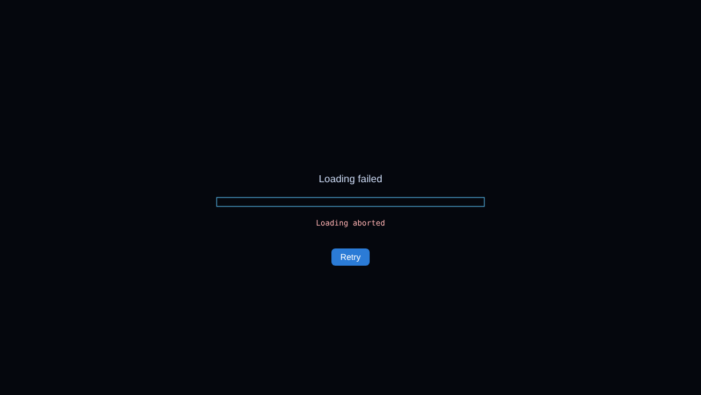
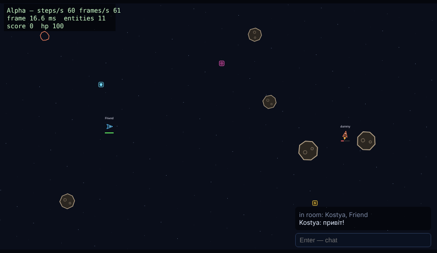
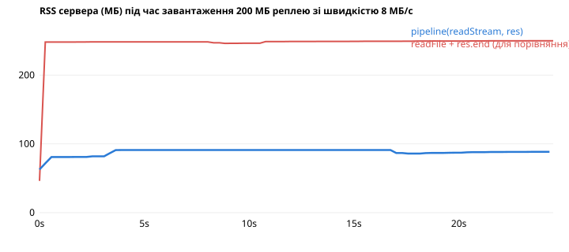

# Space Dogfight

Мультиплеєрна 2D-гра в браузері: космічні кораблі літають по арені, стріляють і ухиляються від астероїдів.
Проєкт курсу «JavaScript програмування» (Р. І. Малькевич), кожна лабораторна — окремий тег `lab-NN`.

## Запуск

```bash
npm install
npm run dev:server   # ігровий сервер на :3000
npm run dev:client   # Vite на http://localhost:5173 (проксі /api і /ws на :3000)
```

Продакшн-режим локально: `npm run build && npm start` → http://localhost:3000

Керування: ← → (або A/D) — поворот, ↑ (W) — тяга, пробіл — постріл, Enter — чат.

---

## Лаб 1. Event loop — це і є ігровий цикл

**Що зроблено**

- `src/loop.js` — `createLoop({ step, simulate, render })`: `requestAnimationFrame` + акумулятор з
  фіксованим кроком 1/60 с і обмеженням кадру 0.25 с (захист від «spiral of death»). Рахує steps/s,
  frames/s і тривалість останнього кадру, `render` отримує `alpha` для інтерполяції.
- `src/input.js` — `createInput(target)`: стан клавіш захований у замиканні, `isDown` / `justPressed`
  (edge-triggered, ігнорує автоповтор `e.repeat`), `endStep()` скидає «щойно натиснуті» в кінці кроку.
- `src/sim/ship.js` — корабель як простий об'єкт `{ x, y, vx, vy, angle, thrust }`, чиста функція
  `integrate(ship, controls, dt)` без DOM. `src/sim/arena.js` — wrap-around по краях.
- `src/render/` — DPR-aware канвас, що змінює розмір разом з вікном; корабель через `translate`/`rotate`,
  полум'я двигуна, зоряне тло. Рендер інтерполює між `previous` і `current` станом, кут — по найкоротшій
  дузі (`lerpAngle`), а при перельоті через край позиція не «розмазується» через усю арену.

**Налаштування керування.** Почав з THRUST 300 і без тертя — корабель розганявся вічно і ним неможливо було
цілитись. Додав експоненційне тертя `DRAG 0.9` (`v *= e^(-DRAG·dt)` — не залежить від кроку),
підняв тягу до 480 і обмежив швидкість 360 px/s. Поворот 3.4 рад/с — повний оберт за ~1.85 с.

### Експерименти (виміряно в Chrome, 1280×720, дисплей 60 Гц)

Режими вмикаються параметрами URL: `?exp=block`, `?exp=interval`, `?exp=variable`, `?autopilot=5`.
Числа — за 10 с роботи, frame time — інтервал між викликами `frame`.

| Режим | steps/s | frames/s | frame p50 | frame p99 | max | σ (джитер) |
|---|---|---|---|---|---|---|
| rAF + акумулятор (норма) | 60 | 60 | 16.7 ms | 16.8 ms | 16.8 ms | 0.06 ms |
| 1. busy-wait 100 мс кожен 60-й кадр | 60 | 55 | 16.7 ms | 100.0 ms | 100.1 ms | 10.53 ms |
| 2. `setInterval(frame, 16)` | 61 | 63 | 16.0 ms | 16.4 ms | 17.9 ms | 0.15 ms |

**1. Блокування 100 мс.** Раз на секунду гра «замерзає» на 0.1 с, а потім корабель стрибає вперед.
frames/s падає до 55, frame time показує 100 мс, але steps/s лишається 60: акумулятор після паузи
проганяє 6 пропущених кроків поспіль, тож симуляція не відстає — відстає лише картинка.
Обійти це з JavaScript неможливо: потік один, і поки `while` крутиться, стек не порожній —
event loop не може взяти з черги ні `requestAnimationFrame`, ні клавіатурну подію, ні таймер.
Будь-який «обхідний» колбек сам стоїть у тій самій черзі. Допомагає лише не блокувати:
розбити роботу на шматки або винести її у Web Worker (Лаб 7).

**2. setInterval замість rAF.** `setInterval(…, 16)` не синхронізований з дисплеєм: 63 «кадри» на 60 Гц
екрані означають, що ~3 кадри на секунду малюються даремно (браузер їх не показує), а джитер у 2.5 рази
більший (σ 0.15 проти 0.06 мс, max 17.9 мс). На фоновій вкладці rAF повністю зупиняється, а `setInterval`
браузер пригальмовує до ~1 разу на секунду; після повернення акумулятор обрізає великий `dt` до 0.25 с,
тому корабель не «телепортується». Повернув rAF.

**3. Змінний крок.** Автопілот 5 с тримає тягу і поворот, потім пише позицію. CPU сповільнений через DevTools
(`Emulation.setCPUThrottlingRate`):

| Крок | CPU 1× | CPU 6× |
|---|---|---|
| змінний (`simulate(dt)` раз на кадр) | (993.758, 457.624) | (999.782, 459.731) — **розходиться на 6 px** |
| фіксований 1/60 + акумулятор | (993.757, 457.660) | (993.757, 457.660) — **збігається повністю** |

Зі змінним кроком інтегрування Ейлера дає різний результат при різному `dt`, тож повільна машина бачить іншу
траєкторію — для мультиплеєра (Лаб 5) це неприпустимо. З фіксованим кроком траєкторія не залежить від FPS.

---

## Лаб 2. Об'єкти, прототипи та this: модель сутностей

**Що зроблено**

- `sim/vector.js` — `Vector2` з чистими методами (`add`, `sub`, `scale`, `dot`, `length`, `normalize`, `rotate`,
  `static fromAngle`): `a.add(b)` повертає новий вектор і не змінює `a`.
- `sim/entity.js` — базовий `Entity` (`id`, `pos`, `vel`, `angle`, `radius`, `alive`, `kind`, `update(dt)`),
  id видає **приватний статичний** лічильник `static #nextId`.
- Ієрархія лише в один рівень: `Ship`, `Bullet` (з TTL), `Asteroid` (дрейфує, відскакує, розколюється),
  `Explosion` (частинки), `Pickup` — усі `extends Entity`, далі ніхто не наслідується.
- `sim/world.js` — `World` зберігає сутності в `#entities: Map`, ітерується через `[Symbol.iterator]`,
  має генератор `*ofKind(kind)`. `despawn(id)` відкладений: сутність позначається мертвою, а з `Map`
  видаляється в `sweep()` в кінці кроку — ніхто не мутує колекцію, поки по ній ітерується `update`.
- `sim/collision.js` — окрема система: `naivePairs(entities)` (O(n²), генерує пари `[a, b]`) і
  `resolveCollisions(world, findPairs)`. Функцію пошуку пар можна підмінити (у Лаб 7 — spatial hash).
- Урон через приватне поле `#hp` з публічним геттером `get hp()`; знищений корабель лишає вибух і
  через 2 с відроджується у вільному місці (`findSafeSpot`) з 1.5 с щита. Рахунок на HUD:
  +3 за корабель, +1 за астероїд.

### Баг з `this`

Спершу постріл був прив'язаний так: `window.addEventListener('keydown', ship.fire)`. При першому ж пострілі:

```
TypeError: Cannot read properties of undefined (reading 'pos')
```

Метод, переданий як колбек, — це просто функція: `ship.fire` «відривається» від об'єкта, і браузер викликає її
з `this = window` (а в модулях/strict mode — `undefined`). `this` визначається не там, де функцію оголошено,
а **як її викликали**. Варіанти виправлення:

1. обгортка-стрілка `() => ship.fire(world)` — стрілка не має свого `this`, а `ship.fire` викликається як метод;
2. `ship.fire.bind(ship)` — створює нову функцію з назавжди прив'язаним `this`;
3. поле класу зі стрілкою `fire = () => {…}` — працює, але створює окрему функцію на кожен екземпляр.

Я обрав інше: клавіатура взагалі не викликає методи корабля. Вона лише заповнює `controls`, а `Ship.update`
сам викликає `this.fire(world)` як метод. Так симуляція не залежить від DOM (і в Лаб 5 той самий код
працюватиме на сервері, куди керування приходить мережею).

### Чому композиція, а не глибоке `extends`

Самонаведення має працювати і для кулі, і для астероїда, а бонус — бути колізійним, але не кораблем.
Через наслідування довелося б робити `HomingBullet extends Bullet` і `HomingAsteroid extends Asteroid` з
дубльованим кодом, або спільного предка `HomingEntity`, від якого неможливо «відчепити» наведення в рантаймі.
Комбінацій (наведення × щит × швидкострільність × тип сутності) стає дедалі більше.

Тому поведінка — це дані:

- `sim/behaviors.js`: `homing({ turnRate, range })` повертає об'єкт з `update(entity, world, dt)`.
  Будь-якій сутності можна зробити `entity.behaviors.push(homing())`. Зараз це використовують
  кулі після бонусу *homing* і один «мисливський» астероїд (помаранчевий) — той самий код.
- `sim/pickup.js`: ефект бонусу — запис у таблиці `EFFECTS` (`shield`, `rapid`, `homing`). Новий бонус —
  один рядок, а не новий клас.

Ціна: поведінки не видно з типу класу, і порядок виконання поведінок треба тримати в голові. Для гри, де
комбінації постійно змінюються, це прийнятно.

---

## Лаб 3. Асинхронний JavaScript: Promises, async/await і екран завантаження

**Що зроблено**

- `public/assets/manifest.json` — спрайт-лист (`sprites.svg`, 7 кадрів 64×64), 4 звуки (згенеровані
  `scripts/gen-sounds.mjs`), 2 арени (`classic`, `belt`).
- `src/assets/loader.js`:
  - `fetchChecked` / `fetchJson` перевіряють `res.ok` (fetch **не** кидає помилку на 404 — це треба робити самому)
    і кидають `HttpError` зі статусом; зіпсований JSON — окрема зрозуміла помилка;
  - `loadImage`, `loadAudio(ctx, url)`, `loadJson` — усі приймають `AbortSignal`;
  - `withRetry(fn, { attempts, baseMs, signal })` — експоненційний backoff з jitter, **не** повторює 4xx і abort;
  - `loadAll(items, { onProgress, signal })` — `Promise.all` з прогресом по кожному елементу. Необов'язкові
    елементи (`required: false`) при помилці не валять гру: використовується векторна графіка або арена за замовчуванням.
- Екран завантаження на канвасі зі справжнім прогрес-баром; гра стартує лише після `await loadAll(...)`.
- Спрайти малюються з листа через `drawImage` з прямокутником-джерелом (`src/render/sprites.js`).
- Звук: `src/audio/audio.js` володіє `AudioContext`, буфери декодуються під час завантаження,
  контекст «розблоковується» першим кліком/клавішею.
- **Симуляція не імпортує ні аудіо, ні HUD.** `World` має шину `bus = new EventTarget()` і шле
  `CustomEvent`-и `fired`, `hit`, `exploded`, `pickup`; на них підписані `audio.js` і `ui/hud.js` (стрічка подій).
- Лобі: `src/ui/lobby.js` — `class Lobby extends EventTarget` з `enter()`, `refresh()`, `join()`, `leave()`
  і подіями `rooms` / `error` / `join`. Поки лобі відкрите, список кімнат (`/api/rooms.json`) оновлюється кожні 3 с,
  кожен запит має `AbortSignal.any([leave, AbortSignal.timeout(2500)])`. Рендер DOM — окремий модуль
  `src/ui/lobby-view.js`, який лише слухає події. Після входу в кімнату за 4 с не було жодного запиту до rooms.json —
  polling і запит, що висів, скасовані.


### Паралельно чи послідовно

Кожен звук віддається з затримкою 300 мс (`?slow=300`, middleware у `vite.config.js`), 3 запуски:

| Спосіб | Час завантаження |
|---|---|
| `Promise.all` | 318, 315, 312 мс |
| послідовні `await` (`?sequential=1`) | 1240, 1245, 1234 мс |

Послідовно час — це сума всіх затримок (4 × 300 мс), паралельно — найдовша з них.

### П'ять задач на порядок виконання

Файл `docs/ordering-puzzles.js`, результати отримані в Chrome:

| # | Код (скорочено) | Вивід | Чому |
|---|---|---|---|
| 1 | `log A; setTimeout(B); Promise.then(C); log D` | `A D C B` | спершу весь синхронний код, потім усі мікрозадачі, потім наступна задача (таймер) |
| 2 | `async f(){ log f1; await null; log f2 }; log start; f(); log end` | `start f1 end f2` | до першого `await` функція йде синхронно; все після нього — мікрозадача |
| 3 | `setTimeout(t0); then(() => { setTimeout(t1); log p1 }); then(p2)` | `p1 p2 t0 t1` | таймер, поставлений у мікрозадачі, стає в кінець черги задач — після `t0` |
| 4 | `rAF(raf); setTimeout(timeout); queueMicrotask(micro); log sync` | `sync micro timeout raf` | rAF виконується перед наступним кадром відмальовки, тобто пізніше за таймер з 0 мс |
| 5 | два ланцюжки `.then(a1).then(a2)` і `.then(b1).then(b2)` | `a1 b1 a2 b2` | кожен `.then` ставить наступну ланку в чергу лише після виконання попередньої, тому ланцюжки чергуються |

### Галерея збоїв

| Збій | Як відтворити | Що бачить гравець |
|---|---|---|
| спрайт 404 | `?missing=1` | лобі відкривається, попередження `HTTP 404 for /assets/nope.svg — fallback used`; повтору не було (4xx) |
| зіпсований JSON | `?badjson=1` | лобі відкривається, попередження `Corrupt JSON… — fallback used`, арена за замовчуванням |
| abort посеред завантаження | `?slow=2000&abort=300` | «Loading failed / Loading aborted» і кнопка **Retry** |
| таймаут мережі | `/api/rooms.json` відповідає 4 с, таймаут 2.5 с | у лобі «Could not load rooms: signal timed out. Retrying…», наступне оновлення пробує знову |

| 404 | Зіпсований JSON | Abort | Таймаут |
|---|---|---|---|
|  |  |  |  |

---

## Лаб 4. Node.js: EventEmitter, streams, WebSocket-сервер

**Структура** — npm workspaces: `client/` (Vite-застосунок з лаб 1–3) і `server/`.

```txt
server/src/
  index.js        http-сервер, API, статика, graceful shutdown
  config.js       PORT, HOST, LOG_DIR, ліміти — з process.env, з перевіркою
  rooms.js        Room extends EventEmitter, RoomManager
  protocol.js     версіоновані JSON-повідомлення v0, validateClientMessage, коди закриття
  ws.js           життєвий цикл сокета, heartbeat, ліміти
  ratelimit.js    token bucket
  static.js       віддача client/dist з MIME і захистом від path traversal
  log/matchlog.js object-mode Transform → NDJSON через pipeline
  log/replay.js   async-генератор по NDJSON-файлу
```

**HTTP** — голий `node:http`: `GET /health`, `GET /api/rooms`, `POST /api/rooms` (тіло ≤ 1 КБ, перевіряється),
`GET /api/replays`, `GET /api/replays/:id` (стрімінг), `GET /api/slow` (навмисне блокування, див. нижче), статика
`client/dist`. Запит `/assets/..%2f..%2f..%2fpackage.json` → `403 forbidden`. У dev Vite проксує `/api` і `/ws`.
На `SIGINT`/`SIGTERM`: `server.close()`, клієнтам `shutdown` і закриття з кодом 1001, дописування логів, `exit(0)`.

**Кімнати і WebSocket.** `Room extends EventEmitter` (`join`, `leave`, `chat`, `empty`, `event`), `RoomManager`
видаляє порожні непостійні кімнати. Після підключення клієнт має надіслати `join` за 5 с. Кожне повідомлення
перевіряється, роster і чат розсилаються кімнаті, ping кожні 15 с, після двох пропущених pong — `terminate()`,
обробник `"error"` на кожному сокеті. Клієнт — `client/src/net/connection.js`: диспетчеризація за `type`,
черга відправки, поки з'єднання встановлюється, reconnect з експоненційним backoff. Лобі тепер бере кімнати
з `/api/rooms`. Два вікна в одній кімнаті бачать одне одного і чат:



**Захист від зловживань** (перевірено скриптом з окремим ws-клієнтом):

| Що робить клієнт | Результат |
|---|---|
| не шле `join` | закрито `4001 join timeout` через 5005 мс |
| шле не-JSON | `4000 not json` |
| шле невідомий тип | `4000 unknown type hack` |
| повідомлення 10 КБ (`maxPayload` 4 КБ) | `1009` (ws закриває сам) |
| 200 повідомлень поспіль (token bucket 30/с, запас 60) | `4002 rate limit` |
| третій гравець у кімнаті `duel` на 2 місця | `4003 room full` |

Повільний клієнт: якщо `bufferedAmount` > 256 КБ, некритичні повідомлення (чат) йому не шлються; якщо > 1 МБ —
`4004 too slow`. Ліміти кімнат і гравців — у `config.js`.

### Логи матчів через streams

Кожна кімната пише події в `logs/<room>-<timestamp>.ndjson`: `events.on(room, 'event')` → `Readable.from(...)` →
object-mode `Transform` (об'єкт → рядок NDJSON) → `createWriteStream`, усе через `pipeline`.
`replay.js` читає файл рядками через `readline` і віддає розпарсені події async-генератором, а
`GET /api/replays/:id` стрімить файл через `pipeline(createReadStream(file), res)`.

**Backpressure.** `server/scripts/gen-big-log.js` створив 200 МБ лог, клієнт качав його з обмеженням 8 МБ/с
(25 с). RSS сервера опитувався кожні 250 мс:



З `pipeline` RSS тримався в межах 63–91 МБ: коли буфер сокета заповнений, `res.write()` повертає `false`,
`pipeline` ставить читання файлу на паузу і продовжує його після `drain`. Для порівняння той самий файл через
`readFile` + `res.end(buf)` — 250 МБ RSS: весь файл лежить у пам'яті, поки повільний клієнт його забирає.

### Event loop, backpressure і падіння процесу

Цикл подій Node проходить фази: **timers** (`setTimeout`/`setInterval`) → **pending callbacks** →
**poll** (нові I/O-події: вхідні з'єднання, дані сокетів, готові файли) → **check** (`setImmediate`) →
**close callbacks**; між колбеками виконуються мікрозадачі (`process.nextTick`, промиси).
Усе це — один потік. Тому синхронний обробник, що працює 300 мс, зупиняє **всіх**: поки він крутиться,
фаза poll не настає, і повідомлення інших гравців просто лежать у буфері ядра.

Демонстрація: два ws-клієнти в кімнаті, один шле повідомлення в чат кожні 50 мс, інший міряє затримку.
Паралельно 5 разів викликаємо `GET /api/slow` (busy-loop 300 мс):

| Умова | p50 | max |
|---|---|---|
| сервер вільний | 1 мс | 2 мс |
| 5 × `/api/slow` | 124 мс | 283 мс |

Чат одного гравця «завис» через запит зовсім іншого клієнта. У грі з тіком 30 Гц (33 мс) це означає
пропущені 8–9 тіків. Виправлення — не робити важку синхронну роботу в обробниках (розбити на шматки або
винести у `worker_threads`).

Backpressure проявився в M3: швидкий диск і повільна мережа — без контролю дані накопичуються в пам'яті
(250 МБ), з `pipeline` — ні.

**Чому одна помилка кладе весь сервер.** Якщо `EventEmitter` емітить `"error"`, а слухача немає, Node кидає
виняток — процес падає разом з усіма кімнатами (`server/scripts/crash-demo.js`):

```text
$ node server/scripts/crash-demo.js crash
tick: other players still being served
node:events:497
      throw er; // Unhandled 'error' event
Error: ECONNRESET from one bad client
exit code: 1

$ node server/scripts/crash-demo.js fixed
tick: other players still being served
[socket] logged and closed: ECONNRESET from one bad client
tick: other players still being served
still alive after the error
```

Виправлення — `ws.on('error', …)` на кожному сокеті (`ws.js`) і `.catch` на кожному обробнику запиту
(`index.js`). Необроблений відхилений проміс з Node 15 так само завершує процес.

Тести: `npm test -w server` (`node:test`) — протокол, token bucket, лог матчу туди-назад.
