# Space Dogfight

[](https://github.com/LKostyaa/space-dogfight/actions/workflows/ci.yml)

**Мультиплеєрний космічний догфайт у браузері.** Авторитетний сервер на Node.js (30 Гц), передбачення
на клієнті, бінарний протокол, TypeScript від клієнта до сервера. Можна встановити на телефон як PWA.

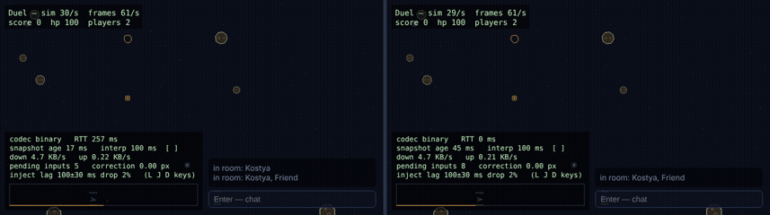

| | |
|---|---|
| ▶ **Грати** | **https://space-dogfight.onrender.com** |
| 📈 **Метрики** | `/metrics` (Prometheus), `/api/stats` (JSON), `/health`, `/ready` |

## Як грати

Відкрийте посилання, введіть ім'я, оберіть кімнату. **← →** (A/D) — поворот, **↑** (W) — тяга, **пробіл** —
постріл, **Enter** — чат. На телефоні — кнопки на екрані. Бонуси: 🛡 щит, ⚡ швидкострільність, ◎ самонавідні
кулі. +3 очки за корабель, +1 за астероїд. **N** — netgraph (RTT, корекції, трафік).

Запустити локально (Node ≥ 22.18):

```bash
npm install
npm run build
npm start            # http://localhost:3000
```

Розробка: `npm run dev:server` + `npm run dev:client` (Vite, http://localhost:5173). Тести: `npm test`, `npm run e2e`.
Продакшн-образ: `GIT_SHA=$(git rev-parse HEAD) docker compose up --build`.

## Архітектура

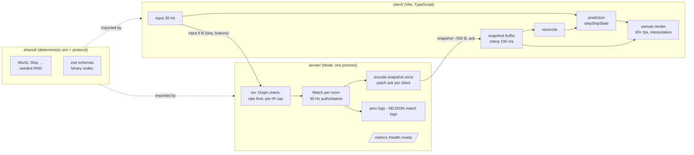

- **Протокол:** WebSocket; керувальні повідомлення — JSON (zod), гарячі — бінарні через `DataView`
  ([docs/protocol.md](docs/protocol.md)). Вхід — 6 байтів, знімок для 4 гравців — ~500 байтів (JSON — 4.9 КБ).
- **Ігровий цикл:** сервер 30 Гц з абсолютним таймером; клієнт симулює теж 30 Гц, малює з частотою екрана.
- **Netcode:** свій корабель передбачається і звіряється з сервером (корекції ~0.01 px), чужі сутності
  інтерполюються зі зсувом 100 мс у минуле, свої кулі з'являються одразу.

## Вимірювання (зведено з лаб)

| Що | Результат | Де |
|---|---|---|
| Фіксований крок vs змінний при 6× CPU throttle | траєкторії збігаються / розходяться на 6 px | [Лаб 1](#лаб-1-event-loop--це-і-є-ігровий-цикл) |
| Завантаження ресурсів: `Promise.all` vs послідовно | 315 мс vs 1240 мс | [Лаб 3](#лаб-3-асинхронний-javascript-promises-asyncawait-і-екран-завантаження) |
| RSS при стрімінгу 200 МБ реплею | 63–91 МБ (`pipeline`) vs 250 МБ (`readFile`) | [Лаб 4](#лаб-4-nodejs-eventemitter-streams-websocket-сервер) |
| Затримка «натиснув → побачив» при 100 мс | 31 мс з передбаченням, 331 мс без | [Лаб 5](#лаб-5-сервер-рахує-гру-передбачення-звірка-і-бінарний-протокол) |
| JSON vs бінарний, 4 гравці, 30 Гц | 144.7 KB/s vs 14.6 KB/s на клієнта | [Лаб 5](#лаб-5-сервер-рахує-гру-передбачення-звірка-і-бінарний-протокол) |
| Тік сервера p99, 64 гравці в одній кімнаті | 4.69 → 2.28 мс після оптимізацій | [Лаб 7](#лаб-7-v8-память-і-тести) |
| Місткість одного процесу | 248 гравців при ELU 17 % (межа — 1-байтовий id і трафік) | [Лаб 7](#лаб-7-v8-память-і-тести) |
| SIGTERM → вихід | 7 мс, код 0; клієнти отримують 1001 за 11 мс | [Лаб 8](#лаб-8-публікуємо-гру-docker-метрики-і-жива-адреса) |
| Флуд сміттям ~1000 кадрів/с | tick p99 сусідньої кімнати 0.60 → 0.45 мс (не зріс) | [Лаб 8](#лаб-8-публікуємо-гру-docker-метрики-і-жива-адреса) |
| Живий сервер (Render free, Франкфурт), гравець з України | RTT 37 мс, кадри бінарні, корекція 0 px | [Лаб 8](#лаб-8-публікуємо-гру-docker-метрики-і-жива-адреса) |

## Обмеження і чому

- **Один процес.** Кімната живе в пам'яті одного процесу, тож горизонтально не масштабується без sticky-сесій або
  Redis. Одного процесу вистачає на ~250 гравців (див. місткість).
- **Не більше 254 гравців на процес** — id гравця займає 1 байт на дроті. Свідомий вибір, щоб зекономити трафік.
- **Інтерполяція = 100 мс у минулому.** Чужі кораблі видно трохи запізно, а компенсації затримки при влучанні
  (lag compensation) немає: стріляти треба з невеликим упередженням.
- **Тунелювання.** Куля (21 px за крок) може проскочити дуже малу ціль — покрито тестом, свіп-колізії не робив.
- **Major GC на клієнті** (2–3 за 30 с, ~4 мс кожен) лишились: декодування знімків створює ~1000 об'єктів/с.
- **Безкоштовний тариф Render** засинає без трафіку: перший гравець чекає ~30 с, поки контейнер прокинеться.

## Що б я робив далі

1. Дельта-знімки (лише змінені сутності) — у профілі сервера тепер домінує `writev`.
2. Lag compensation: сервер перевіряє влучання в минулому стані світу, який бачив стрілець.
3. Sticky routing за id кімнати (Caddy/nginx hash) → кілька процесів; далі Redis pub/sub, щоб кімната жила на кількох.
4. Матчмейкінг і акаунти; декодування знімків у пул об'єктів (нуль major GC).

## Історія тегів

| Тег | Що з'явилося |
|---|---|
| `lab-01` | ігровий цикл з фіксованим кроком, корабель, експерименти з event loop |
| `lab-02` | сутності, `World` на `Map`, колізії, бонуси через композицію |
| `lab-03` | завантаження з retry/abort, спрайти, Web Audio, шина подій, лобі |
| `lab-04` | Node-сервер: кімнати, WebSocket, логи матчів через streams, ліміти |
| `lab-05` | авторитетний сервер, передбачення, звірка, інтерполяція, бінарний протокол |
| `lab-06` | TypeScript скрізь, zod-протокол, типізовані події |
| `lab-07` | 88 тестів, e2e, CI, профілювання, боти, навантажувальний тест |
| `lab-08`, `v1.0.0` | продакшн: SIGTERM, health/ready/metrics, Docker, деплой за тегом, PWA |

---

# Журнал лабораторних

## Лаб 1. Event loop — це і є ігровий цикл

**Що зроблено**

- `src/loop.js` — `createLoop({ step, simulate, render })`: `requestAnimationFrame` + акумулятор з
  фіксованим кроком 1/60 с і обмеженням кадру 0.25 с (захист від «spiral of death»). Рахує steps/s,
  frames/s і тривалість останнього кадру, `render` отримує `alpha` для інтерполяції.
- `src/input.js` — `createInput(target)`: стан клавіш захований у замиканні, `isDown` / `justPressed`
  (edge-triggered, ігнорує автоповтор `e.repeat`), `endStep()` скидає «щойно натиснуті» в кінці кроку.
- `src/sim/ship.js` — корабель як простий об'єкт `{ x, y, vx, vy, angle, thrust }`, чиста функція
  `integrate(ship, controls, dt)` без DOM. `src/sim/arena.js` — wrap-around по краях.
- `src/render/` — DPR-aware канвас, що змінює розмір разом з вікном; корабель через `translate`/`rotate`,
  полум'я двигуна, зоряне тло. Рендер інтерполює між `previous` і `current` станом, кут — по найкоротшій
  дузі (`lerpAngle`), а при перельоті через край позиція не «розмазується» через усю арену.

**Налаштування керування.** Почав з THRUST 300 і без тертя — корабель розганявся вічно і ним неможливо було
цілитись. Додав експоненційне тертя `DRAG 0.9` (`v *= e^(-DRAG·dt)` — не залежить від кроку),
підняв тягу до 480 і обмежив швидкість 360 px/s. Поворот 3.4 рад/с — повний оберт за ~1.85 с.

### Експерименти (виміряно в Chrome, 1280×720, дисплей 60 Гц)

Режими вмикаються параметрами URL: `?exp=block`, `?exp=interval`, `?exp=variable`, `?autopilot=5`.
Числа — за 10 с роботи, frame time — інтервал між викликами `frame`.

| Режим | steps/s | frames/s | frame p50 | frame p99 | max | σ (джитер) |
|---|---|---|---|---|---|---|
| rAF + акумулятор (норма) | 60 | 60 | 16.7 ms | 16.8 ms | 16.8 ms | 0.06 ms |
| 1. busy-wait 100 мс кожен 60-й кадр | 60 | 55 | 16.7 ms | 100.0 ms | 100.1 ms | 10.53 ms |
| 2. `setInterval(frame, 16)` | 61 | 63 | 16.0 ms | 16.4 ms | 17.9 ms | 0.15 ms |

**1. Блокування 100 мс.** Раз на секунду гра «замерзає» на 0.1 с, а потім корабель стрибає вперед.
frames/s падає до 55, frame time показує 100 мс, але steps/s лишається 60: акумулятор після паузи
проганяє 6 пропущених кроків поспіль, тож симуляція не відстає — відстає лише картинка.
Обійти це з JavaScript неможливо: потік один, і поки `while` крутиться, стек не порожній —
event loop не може взяти з черги ні `requestAnimationFrame`, ні клавіатурну подію, ні таймер.
Будь-який «обхідний» колбек сам стоїть у тій самій черзі. Допомагає лише не блокувати:
розбити роботу на шматки або винести її у Web Worker (Лаб 7).

**2. setInterval замість rAF.** `setInterval(…, 16)` не синхронізований з дисплеєм: 63 «кадри» на 60 Гц
екрані означають, що ~3 кадри на секунду малюються даремно (браузер їх не показує), а джитер у 2.5 рази
більший (σ 0.15 проти 0.06 мс, max 17.9 мс). На фоновій вкладці rAF повністю зупиняється, а `setInterval`
браузер пригальмовує до ~1 разу на секунду; після повернення акумулятор обрізає великий `dt` до 0.25 с,
тому корабель не «телепортується». Повернув rAF.

**3. Змінний крок.** Автопілот 5 с тримає тягу і поворот, потім пише позицію. CPU сповільнений через DevTools
(`Emulation.setCPUThrottlingRate`):

| Крок | CPU 1× | CPU 6× |
|---|---|---|
| змінний (`simulate(dt)` раз на кадр) | (993.758, 457.624) | (999.782, 459.731) — **розходиться на 6 px** |
| фіксований 1/60 + акумулятор | (993.757, 457.660) | (993.757, 457.660) — **збігається повністю** |

Зі змінним кроком інтегрування Ейлера дає різний результат при різному `dt`, тож повільна машина бачить іншу
траєкторію — для мультиплеєра (Лаб 5) це неприпустимо. З фіксованим кроком траєкторія не залежить від FPS.

---

## Лаб 2. Об'єкти, прототипи та this: модель сутностей

**Що зроблено**

- `sim/vector.js` — `Vector2` з чистими методами (`add`, `sub`, `scale`, `dot`, `length`, `normalize`, `rotate`,
  `static fromAngle`): `a.add(b)` повертає новий вектор і не змінює `a`.
- `sim/entity.js` — базовий `Entity` (`id`, `pos`, `vel`, `angle`, `radius`, `alive`, `kind`, `update(dt)`),
  id видає **приватний статичний** лічильник `static #nextId`.
- Ієрархія лише в один рівень: `Ship`, `Bullet` (з TTL), `Asteroid` (дрейфує, відскакує, розколюється),
  `Explosion` (частинки), `Pickup` — усі `extends Entity`, далі ніхто не наслідується.
- `sim/world.js` — `World` зберігає сутності в `#entities: Map`, ітерується через `[Symbol.iterator]`,
  має генератор `*ofKind(kind)`. `despawn(id)` відкладений: сутність позначається мертвою, а з `Map`
  видаляється в `sweep()` в кінці кроку — ніхто не мутує колекцію, поки по ній ітерується `update`.
- `sim/collision.js` — окрема система: `naivePairs(entities)` (O(n²), генерує пари `[a, b]`) і
  `resolveCollisions(world, findPairs)`. Функцію пошуку пар можна підмінити (у Лаб 7 — spatial hash).
- Урон через приватне поле `#hp` з публічним геттером `get hp()`; знищений корабель лишає вибух і
  через 2 с відроджується у вільному місці (`findSafeSpot`) з 1.5 с щита. Рахунок на HUD:
  +3 за корабель, +1 за астероїд.

### Баг з `this`

Спершу постріл був прив'язаний так: `window.addEventListener('keydown', ship.fire)`. При першому ж пострілі:

```
TypeError: Cannot read properties of undefined (reading 'pos')
```

Метод, переданий як колбек, — це просто функція: `ship.fire` «відривається» від об'єкта, і браузер викликає її
з `this = window` (а в модулях/strict mode — `undefined`). `this` визначається не там, де функцію оголошено,
а **як її викликали**. Варіанти виправлення:

1. обгортка-стрілка `() => ship.fire(world)` — стрілка не має свого `this`, а `ship.fire` викликається як метод;
2. `ship.fire.bind(ship)` — створює нову функцію з назавжди прив'язаним `this`;
3. поле класу зі стрілкою `fire = () => {…}` — працює, але створює окрему функцію на кожен екземпляр.

Я обрав інше: клавіатура взагалі не викликає методи корабля. Вона лише заповнює `controls`, а `Ship.update`
сам викликає `this.fire(world)` як метод. Так симуляція не залежить від DOM (і в Лаб 5 той самий код
працюватиме на сервері, куди керування приходить мережею).

### Чому композиція, а не глибоке `extends`

Самонаведення має працювати і для кулі, і для астероїда, а бонус — бути колізійним, але не кораблем.
Через наслідування довелося б робити `HomingBullet extends Bullet` і `HomingAsteroid extends Asteroid` з
дубльованим кодом, або спільного предка `HomingEntity`, від якого неможливо «відчепити» наведення в рантаймі.
Комбінацій (наведення × щит × швидкострільність × тип сутності) стає дедалі більше.

Тому поведінка — це дані:

- `sim/behaviors.js`: `homing({ turnRate, range })` повертає об'єкт з `update(entity, world, dt)`.
  Будь-якій сутності можна зробити `entity.behaviors.push(homing())`. Зараз це використовують
  кулі після бонусу *homing* і один «мисливський» астероїд (помаранчевий) — той самий код.
- `sim/pickup.js`: ефект бонусу — запис у таблиці `EFFECTS` (`shield`, `rapid`, `homing`). Новий бонус —
  один рядок, а не новий клас.

Ціна: поведінки не видно з типу класу, і порядок виконання поведінок треба тримати в голові. Для гри, де
комбінації постійно змінюються, це прийнятно.

---

## Лаб 3. Асинхронний JavaScript: Promises, async/await і екран завантаження

**Що зроблено**

- `public/assets/manifest.json` — спрайт-лист (`sprites.svg`, 7 кадрів 64×64), 4 звуки (згенеровані
  `scripts/gen-sounds.mjs`), 2 арени (`classic`, `belt`).
- `src/assets/loader.js`:
  - `fetchChecked` / `fetchJson` перевіряють `res.ok` (fetch **не** кидає помилку на 404 — це треба робити самому)
    і кидають `HttpError` зі статусом; зіпсований JSON — окрема зрозуміла помилка;
  - `loadImage`, `loadAudio(ctx, url)`, `loadJson` — усі приймають `AbortSignal`;
  - `withRetry(fn, { attempts, baseMs, signal })` — експоненційний backoff з jitter, **не** повторює 4xx і abort;
  - `loadAll(items, { onProgress, signal })` — `Promise.all` з прогресом по кожному елементу. Необов'язкові
    елементи (`required: false`) при помилці не валять гру: використовується векторна графіка або арена за замовчуванням.
- Екран завантаження на канвасі зі справжнім прогрес-баром; гра стартує лише після `await loadAll(...)`.
- Спрайти малюються з листа через `drawImage` з прямокутником-джерелом (`src/render/sprites.js`).
- Звук: `src/audio/audio.js` володіє `AudioContext`, буфери декодуються під час завантаження,
  контекст «розблоковується» першим кліком/клавішею.
- **Симуляція не імпортує ні аудіо, ні HUD.** `World` має шину `bus = new EventTarget()` і шле
  `CustomEvent`-и `fired`, `hit`, `exploded`, `pickup`; на них підписані `audio.js` і `ui/hud.js` (стрічка подій).
- Лобі: `src/ui/lobby.js` — `class Lobby extends EventTarget` з `enter()`, `refresh()`, `join()`, `leave()`
  і подіями `rooms` / `error` / `join`. Поки лобі відкрите, список кімнат (`/api/rooms.json`) оновлюється кожні 3 с,
  кожен запит має `AbortSignal.any([leave, AbortSignal.timeout(2500)])`. Рендер DOM — окремий модуль
  `src/ui/lobby-view.js`, який лише слухає події. Після входу в кімнату за 4 с не було жодного запиту до rooms.json —
  polling і запит, що висів, скасовані.

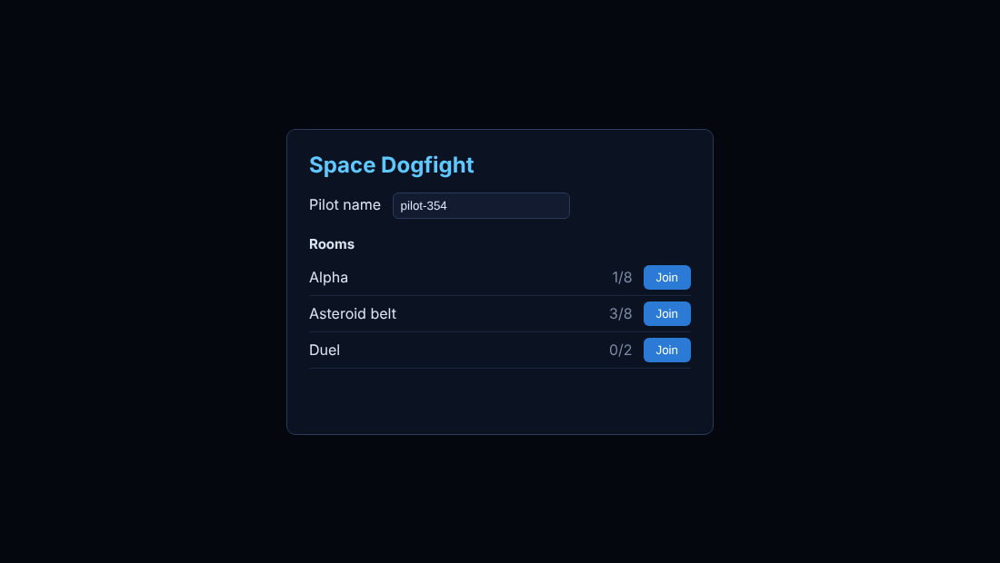

### Паралельно чи послідовно

Кожен звук віддається з затримкою 300 мс (`?slow=300`, middleware у `vite.config.js`), 3 запуски:

| Спосіб | Час завантаження |
|---|---|
| `Promise.all` | 318, 315, 312 мс |
| послідовні `await` (`?sequential=1`) | 1240, 1245, 1234 мс |

Послідовно час — це сума всіх затримок (4 × 300 мс), паралельно — найдовша з них.

### П'ять задач на порядок виконання

Файл `docs/ordering-puzzles.js`, результати отримані в Chrome:

| # | Код (скорочено) | Вивід | Чому |
|---|---|---|---|
| 1 | `log A; setTimeout(B); Promise.then(C); log D` | `A D C B` | спершу весь синхронний код, потім усі мікрозадачі, потім наступна задача (таймер) |
| 2 | `async f(){ log f1; await null; log f2 }; log start; f(); log end` | `start f1 end f2` | до першого `await` функція йде синхронно; все після нього — мікрозадача |
| 3 | `setTimeout(t0); then(() => { setTimeout(t1); log p1 }); then(p2)` | `p1 p2 t0 t1` | таймер, поставлений у мікрозадачі, стає в кінець черги задач — після `t0` |
| 4 | `rAF(raf); setTimeout(timeout); queueMicrotask(micro); log sync` | `sync micro timeout raf` | rAF виконується перед наступним кадром відмальовки, тобто пізніше за таймер з 0 мс |
| 5 | два ланцюжки `.then(a1).then(a2)` і `.then(b1).then(b2)` | `a1 b1 a2 b2` | кожен `.then` ставить наступну ланку в чергу лише після виконання попередньої, тому ланцюжки чергуються |

### Галерея збоїв

| Збій | Як відтворити | Що бачить гравець |
|---|---|---|
| спрайт 404 | `?missing=1` | лобі відкривається, попередження `HTTP 404 for /assets/nope.svg — fallback used`; повтору не було (4xx) |
| зіпсований JSON | `?badjson=1` | лобі відкривається, попередження `Corrupt JSON… — fallback used`, арена за замовчуванням |
| abort посеред завантаження | `?slow=2000&abort=300` | «Loading failed / Loading aborted» і кнопка **Retry** |
| таймаут мережі | `/api/rooms.json` відповідає 4 с, таймаут 2.5 с | у лобі «Could not load rooms: signal timed out. Retrying…», наступне оновлення пробує знову |

| 404 | Зіпсований JSON | Abort | Таймаут |
|---|---|---|---|
|  | 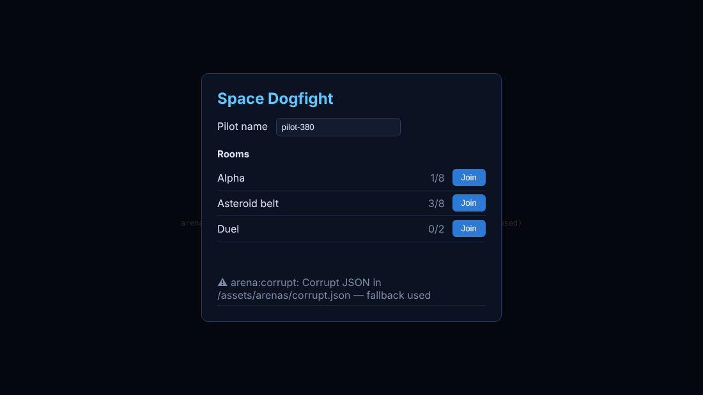 |  | 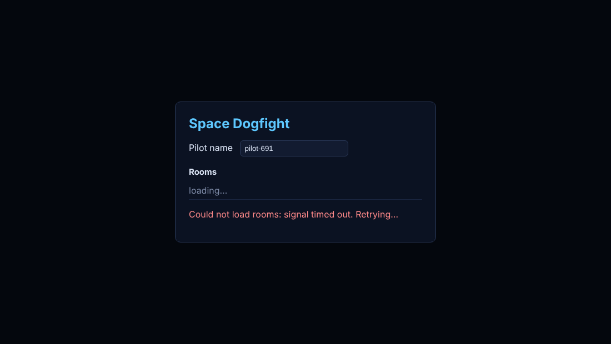 |

---

## Лаб 4. Node.js: EventEmitter, streams, WebSocket-сервер

**Структура** — npm workspaces: `client/` (Vite-застосунок з лаб 1–3) і `server/`.

```txt
server/src/
  index.js        http-сервер, API, статика, graceful shutdown
  config.js       PORT, HOST, LOG_DIR, ліміти — з process.env, з перевіркою
  rooms.js        Room extends EventEmitter, RoomManager
  protocol.js     версіоновані JSON-повідомлення v0, validateClientMessage, коди закриття
  ws.js           життєвий цикл сокета, heartbeat, ліміти
  ratelimit.js    token bucket
  static.js       віддача client/dist з MIME і захистом від path traversal
  log/matchlog.js object-mode Transform → NDJSON через pipeline
  log/replay.js   async-генератор по NDJSON-файлу
```

**HTTP** — голий `node:http`: `GET /health`, `GET /api/rooms`, `POST /api/rooms` (тіло ≤ 1 КБ, перевіряється),
`GET /api/replays`, `GET /api/replays/:id` (стрімінг), `GET /api/slow` (навмисне блокування, див. нижче), статика
`client/dist`. Запит `/assets/..%2f..%2f..%2fpackage.json` → `403 forbidden`. У dev Vite проксує `/api` і `/ws`.
На `SIGINT`/`SIGTERM`: `server.close()`, клієнтам `shutdown` і закриття з кодом 1001, дописування логів, `exit(0)`.

**Кімнати і WebSocket.** `Room extends EventEmitter` (`join`, `leave`, `chat`, `empty`, `event`), `RoomManager`
видаляє порожні непостійні кімнати. Після підключення клієнт має надіслати `join` за 5 с. Кожне повідомлення
перевіряється, роster і чат розсилаються кімнаті, ping кожні 15 с, після двох пропущених pong — `terminate()`,
обробник `"error"` на кожному сокеті. Клієнт — `client/src/net/connection.js`: диспетчеризація за `type`,
черга відправки, поки з'єднання встановлюється, reconnect з експоненційним backoff. Лобі тепер бере кімнати
з `/api/rooms`. Два вікна в одній кімнаті бачать одне одного і чат:


**Захист від зловживань** (перевірено скриптом з окремим ws-клієнтом):

| Що робить клієнт | Результат |
|---|---|
| не шле `join` | закрито `4001 join timeout` через 5005 мс |
| шле не-JSON | `4000 not json` |
| шле невідомий тип | `4000 unknown type hack` |
| повідомлення 10 КБ (`maxPayload` 4 КБ) | `1009` (ws закриває сам) |
| 200 повідомлень поспіль (token bucket 30/с, запас 60) | `4002 rate limit` |
| третій гравець у кімнаті `duel` на 2 місця | `4003 room full` |

Повільний клієнт: якщо `bufferedAmount` > 256 КБ, некритичні повідомлення (чат) йому не шлються; якщо > 1 МБ —
`4004 too slow`. Ліміти кімнат і гравців — у `config.js`.

### Логи матчів через streams

Кожна кімната пише події в `logs/<room>-<timestamp>.ndjson`: `events.on(room, 'event')` → `Readable.from(...)` →
object-mode `Transform` (об'єкт → рядок NDJSON) → `createWriteStream`, усе через `pipeline`.
`replay.js` читає файл рядками через `readline` і віддає розпарсені події async-генератором, а
`GET /api/replays/:id` стрімить файл через `pipeline(createReadStream(file), res)`.

**Backpressure.** `server/scripts/gen-big-log.js` створив 200 МБ лог, клієнт качав його з обмеженням 8 МБ/с
(25 с). RSS сервера опитувався кожні 250 мс:


З `pipeline` RSS тримався в межах 63–91 МБ: коли буфер сокета заповнений, `res.write()` повертає `false`,
`pipeline` ставить читання файлу на паузу і продовжує його після `drain`. Для порівняння той самий файл через
`readFile` + `res.end(buf)` — 250 МБ RSS: весь файл лежить у пам'яті, поки повільний клієнт його забирає.

### Event loop, backpressure і падіння процесу

Цикл подій Node проходить фази: **timers** (`setTimeout`/`setInterval`) → **pending callbacks** →
**poll** (нові I/O-події: вхідні з'єднання, дані сокетів, готові файли) → **check** (`setImmediate`) →
**close callbacks**; між колбеками виконуються мікрозадачі (`process.nextTick`, промиси).
Усе це — один потік. Тому синхронний обробник, що працює 300 мс, зупиняє **всіх**: поки він крутиться,
фаза poll не настає, і повідомлення інших гравців просто лежать у буфері ядра.

Демонстрація: два ws-клієнти в кімнаті, один шле повідомлення в чат кожні 50 мс, інший міряє затримку.
Паралельно 5 разів викликаємо `GET /api/slow` (busy-loop 300 мс):

| Умова | p50 | max |
|---|---|---|
| сервер вільний | 1 мс | 2 мс |
| 5 × `/api/slow` | 124 мс | 283 мс |

Чат одного гравця «завис» через запит зовсім іншого клієнта. У грі з тіком 30 Гц (33 мс) це означає
пропущені 8–9 тіків. Виправлення — не робити важку синхронну роботу в обробниках (розбити на шматки або
винести у `worker_threads`).

Backpressure проявився в M3: швидкий диск і повільна мережа — без контролю дані накопичуються в пам'яті
(250 МБ), з `pipeline` — ні.

**Чому одна помилка кладе весь сервер.** Якщо `EventEmitter` емітить `"error"`, а слухача немає, Node кидає
виняток — процес падає разом з усіма кімнатами (`server/scripts/crash-demo.js`):

```text
$ node server/scripts/crash-demo.js crash
tick: other players still being served
node:events:497
      throw er; // Unhandled 'error' event
Error: ECONNRESET from one bad client
exit code: 1

$ node server/scripts/crash-demo.js fixed
tick: other players still being served
[socket] logged and closed: ECONNRESET from one bad client
tick: other players still being served
still alive after the error
```

Виправлення — `ws.on('error', …)` на кожному сокеті (`ws.js`) і `.catch` на кожному обробнику запиту
(`index.js`). Необроблений відхилений проміс з Node 15 так само завершує процес.

Тести: `npm test -w server` (`node:test`) — протокол, token bucket, лог матчу туди-назад.

---

## Лаб 5. Сервер рахує гру: передбачення, звірка і бінарний протокол

**Структура.** Новий пакет `shared/` (імпортують і клієнт, і сервер):

```txt
shared/src/
  sim/        World, Ship, Bullet, … (переїхали з client/), seeded PRNG, TICK_RATE = 30
  protocol/   типи повідомлень, кнопки, коди сутностей і подій
  codec/      json.js і binary.js (DataView), однаковий інтерфейс
  net/        worldToSnapshot(), reconcile()
shared/test/  детермінізм, кодек туди-назад, reconcile
```

`node --test` у `shared/` доводить, що симуляція імпортується і працює в Node без DOM, а два прогони з однаковим
seed і однаковими входами дають однаковий SHA-256 стану світу (900 кроків).

**Сервер** (`server/src/match.js`) — `Match` на кожну кімнату, 30 Гц. Таймер рахує **абсолютний** час наступного
тіку (`nextAt += 33.3`), тому похибки `setTimeout` не накопичуються. Тривалість тіку і джитер (p50/p99) —
у `GET /api/stats`. Входи гравців ідуть у чергу (перевірка `seq`, не більше 8 у черзі, не більше 3 за тік).

Важливе рішення, знайдене під час налагодження: корабель гравця рухається **один раз на кожен вхід**, а не раз на
тік (`Ship.applyInput`). Спочатку сервер на тіках без нового входу повторював попереднє керування, і корабель робив
крок, якого клієнт не передбачав. Навіть без затримки корекції стабільно були близько 10 px. Після виправлення — 0.01 px
(це вже похибка квантування).

**Клієнт** (`client/src/net/netgame.js`):

- **передбачення:** свій корабель рахується одразу тією самою `stepShipState`, що й на сервері; кожен вхід з `seq`
  іде в буфер `pending`;
- **звірка:** на кожен знімок беремо позицію сервера, викидаємо входи з `seq ≤ ack`, решту застосовуємо повторно
  (`shared/net/reconcile.js` — чиста функція). Різниця між старим і новим передбаченням іде в зсув `smooth`, який
  згасає за ~100 мс, тож ривків не видно;
- **інтерполяція:** усе інше малюється на `interpDelay` (за замовчуванням 100 мс, змінюється `[` `]`) у минулому між
  двома знімками. Годинник: мінімум з `(час прибуття − tick·33.3)` — найменш затриманий знімок. Сутність, якої немає
  в наступному знімку, зникає; нова — з'являється, коли час рендеру до неї доходить;
- **кулі:** свої кулі з'являються одразу (передбачені). Серверна куля з тим самим `(owner, seq)` ховається, поки живе
  передбачена; якщо серверна зникла (влучила) — передбачена теж зникає;
- **інжектор затримки** (`net/latency.js`): затримка, джитер і втрати в обидва боки (`?lag=100&jitter=30&drop=2` або
  клавіші L, J, D). Через джитер повідомлення приходять не по порядку — старі знімки і старі `seq` ігноруються;
- **netgraph** (N): RTT (ping/pong), вік знімка, затримка інтерполяції, KB/s вниз/вгору, кількість входів у дорозі,
  величина корекції і її графік.

### Вимірювання

**Затримка «натиснув → побачив»** (від `keydown` до першої зміни намальованого кута корабля, медіана з 5):

| Режим | Затримка |
|---|---|
| без передбачення (`?predict=0`), 0 мс | 130 мс |
| без передбачення, 100 мс в один бік | 331 мс |
| з передбаченням, 100 мс в один бік | 31 мс (≤ один крок 30 Гц) |

Без передбачення гравець чекає RTT + затримку інтерполяції + тік — керувати кораблем так неможливо.

**Детермінізм навмисно зламаний** (`?breakdet=1` — до `stepShipState` на клієнті домішується `Math.random()`), 100 мс:

| | Корекція, медіана | максимум |
|---|---|---|
| детермінована фізика | 0.014 px | 0.030 px |
| з `Math.random()` | 1.12 px | 3.12 px |

Корабель починає «тремтіти», а графік корекцій на netgraph перетворюється на суцільну пилу.

| Норма | Зламаний детермінізм |
|---|---|
| 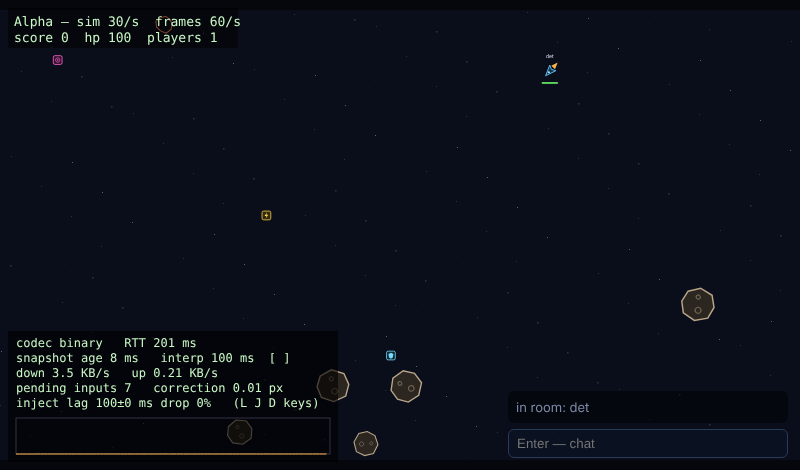 | 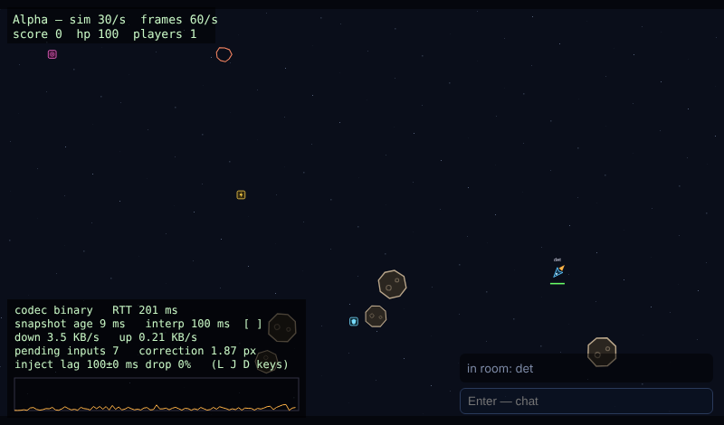 |

**JSON vs бінарний протокол** — 30 Гц, 4 гравці в кімнаті `belt` (~35 сутностей), 5 с вимірювання, кодування+декодування —
середнє з 20 000 повторів на останньому реальному знімку (`node`, той самий комп'ютер):

| Кодек | Байтів/знімок | KB/s на клієнта (вниз) | KB/s на клієнта (вгору) | encode+decode |
|---|---|---|---|---|
| JSON | 4939 | 144.7 | 1.11 | 38.6 µs |
| Binary (`DataView`) | 500 | 14.6 | 0.18 | 8.4 µs |

Бінарний формат у **9.9 раза** менший і в 4.6 раза швидший. Специфікація — [docs/protocol.md](docs/protocol.md),
тести туди-назад — `shared/test/codec.test.js` (у т. ч. кожен обрізаний префікс валідного буфера → `CodecError`).

GIF угорі README: два вікна в одній кімнаті при 100 ± 30 мс і 2 % втрат. RTT ≈ 205 мс, медіана корекції 0.015 px,
максимум 10 px (зіткнення з астероїдом, якого клієнт не передбачає).

### Netcode: як влаштовано і чому

**Три проблеми мережевої гри.**
1. *Затримка* — сигнал від гравця до сервера і назад іде 50–300 мс. Рішення: передбачення свого корабля
   на клієнті + звірка з сервером; чужі об'єкти — інтерполяція з невеликою затримкою.
2. *Узгодженість* — у всіх гравців має бути один світ. Рішення: авторитетний сервер; клієнт лише
   показує знімки і передбачає себе тим самим детермінованим кодом (`shared/`), тож прогноз майже завжди збігається.
3. *Чітерство* — клієнту не можна вірити. Рішення: клієнт надсилає лише натиснуті кнопки (6 байтів), а не позицію;
   сервер перевіряє кожне повідомлення, обмежує кількість входів за тік (не можна «прискоритися», надсилаючи 60 входів
   на секунду) і сам рахує влучання і рахунок.

**Що показав netgraph.** До передбачення при 100 мс корабель реагував через третину секунди. Після — миттєво,
корекції ~0.01 px у відкритому космосі і сплески до кількох пікселів при зіткненнях з астероїдами і на
відродженні (сервер вирішує, клієнт дізнається пізніше).

**Баг детермінізму**, на який я натрапив, — не `Math.random()`, а різна кількість кроків: сервер рухав корабель
на кожному тіку, навіть без нових входів (див. вище). Другий кандидат — квантування позиції в бінарному кодеку:
звірка йде від квантованої позиції, тому після кожного знімка лишається 0.01–0.03 px розбіжності. Це менше
пікселя, тож я залишив як є.

**Затримка інтерполяції.** 100 мс = 3 знімки при 30 Гц. При 2 % втрат і ±30 мс джитера буфер майже ніколи не
спорожнюється (якщо час рендеру обганяє останній знімок, чужі кораблі «зависають»). 50 мс давали помітні ривки
при джитері, 150+ мс — чужі кораблі відчутно «в минулому», важче влучати. Значення можна змінювати на льоту (`[` `]`).

---

## Лаб 6. TypeScript для протоколу і симуляції

Усі три пакети — TypeScript у режимі `strict` + `noUncheckedIndexedAccess` + `verbatimModuleSyntax` +
`erasableSyntaxOnly` (`tsconfig.base.json`, у кожному пакеті свій `tsconfig.json`). `npm run typecheck` у корені
проганяє `tsc --noEmit` у кожному workspace. Мінімальний GitHub Actions (`.github/workflows/ci.yml`) запускає
typecheck і тести на кожен push.

**Як запускається.** Сервер і тести виконує сам Node — його вбудоване *type stripping* (Node ≥ 22.18):
`node src/index.ts`, без збірки і без `tsx`. Тому в коді немає `enum`, `namespace` і parameter properties —
лише синтаксис, який можна просто стерти (`erasableSyntaxOnly`), а імпорти пишуться з розширенням `.ts`
(`allowImportingTsExtensions`). Клієнт збирає Vite.

**Порядок міграції:** спершу `shared/`, потім сервер, потім клієнт. Тест детермінізму з Лаб 5
(SHA-256 стану світу після 900 кроків) проходив після кожного кроку, а netcode-вимірювання дають ті самі
числа (RTT 201 мс при 100 мс затримки, корекції 0.01–0.03 px), тобто поведінка під час виконання не змінилась.

**Що зроблено:**

- `shared/src/types.ts` — брендовані `EntityId`, `PlayerId`, `Tick`, `Seq`; `Result<T, E>`; `assertNever`.
- `Vector2` з `readonly x, y`; знімки й повідомлення — `Readonly`.
- Сутності — розмічене об'єднання: у кожного класу `readonly kind = 'ship'` (літерал), `AnyEntity = Ship | Bullet | …`,
  `world.ofKind('ship')` повертає `Generator<Ship>` без жодного приведення типу (type predicate `isKind`).
- `shared/src/protocol.ts` — **єдине джерело правди**: zod-схеми всіх JSON-повідомлень в обидва боки,
  типи виводяться з них (`z.infer`). `parseClientMessage(data: unknown): Result<ClientMessage>` ніколи не кидає
  винятків. Ручний валідатор з Лаб 4 видалено.
- Кодеки реалізують інтерфейс `Codec` (`json.ts`, `binary.ts`); бінарний декодер перевіряє версію, межі і значення.
- Кожен `switch` по `type`/`kind` закінчується `default: assertNever(x)` — новий тип повідомлення без обробки
  не скомпілюється.
- Типізовані події: `Room extends EventEmitter<RoomEvents>` (Node-генерик), на клієнті `Bus<E>` — `EventTarget`
  з типізованими `emit`/`on` (`Lobby`, `Connection`, ігрова шина `Bus<ClientEvents>`).
- Конфіг сервера — zod-схема `ServerConfigSchema` з дефолтами; `MAX_ROOMS=abc` → зрозуміла помилка при старті.
- `catch (e: unknown)` скрізь, з перевіркою `instanceof`.
- **0 `any`, 2 `as`** на весь код, обидва з коментарем: `toId()` у `types.ts` (бренд існує лише в типах) і
  `world.emit()` (TypeScript не корелює generic-ключ через spread, TS#30581).

**Фреймворк** для лобі і HUD я не брав. Лобі — це один список кнопок і поле вводу, HUD малюється на канвасі.
`Bus` + DOM з Лаб 3 займають ~60 рядків, а React/Svelte додали б залежність і крок збірки, не прибравши
жодної реальної складності. Канвас і ігровий цикл за правилами курсу лишаються без фреймворку.

### Що знайшов TypeScript

1. **`RawData` з `ws` — не завжди `Buffer`.** Сервер робив `data.buffer.slice(...)`, але фрагментоване повідомлення
   приходить як `Buffer[]`, і цей код би впав. Тепер `toArrayBuffer()` обробляє всі три варіанти.
2. **Куля могла «вдарити» вибух.** `Bullet.onCollide` викликав `other.damage(...)` для всього, крім себе, куль
   і бонусів. У `Explosion` немає `damage` — у JS це не падало лише тому, що вибухи не колізійні. Тепер виключення явне.
3. **`by: undefined` у подіях.** `attacker?.playerId` давав `undefined`, коли корабель розбився об астероїд;
   у знімку це випадково ставало 0. Тип `by: PlayerId | 0` змусив записати це явно.
4. **`Map.get` / індекси без перевірки** (`noUncheckedIndexedAccess`): `list[i]` у пошуку колізій,
   `PALETTE[id % 8]`, `buffer[i + 1]` в інтерполяції, `EFFECT_NAMES[rng.int(3)]` — усі тепер обробляють `undefined`.
5. **Сплутані id.** HUD шукав ім'я гравця за `playerId` з події (просто число), а мапа була з ключем `PlayerId`.
   Бренди не дали передати «будь-яке число» туди, де очікується id гравця.
6. **Мовчазний fallback кодека.** `getCodec(name)` повертав бінарний кодек для будь-якого невідомого імені;
   тепер `name: 'binary' | 'json'`, помилка в назві — помилка компіляції.
7. **`seq` кулі — 16 біт, а `seq` клієнта — 32.** Помітив, коли писав схему (`uint.max(0xffff)`): після 65 535 входів
   (~36 хв гри) передбачені кулі перестали б зіставлятися з серверними. Порівняння тепер по `seq & 0xffff`.
8. **`getContext('2d')` може повернути `null`**, а `JSON.parse` відповіді лобі — що завгодно: відповідь `/api/rooms`
   тепер перевіряє zod.

### Три типи, які варто пояснити

```ts
// 1. Бренд: на рантаймі це просто number, але EntityId і PlayerId не можна переплутати.
type Brand<T, B extends string> = T & { readonly [brand]: B }
type PlayerId = Brand<number, 'PlayerId'>
```
Перетин з полем, якого насправді немає, робить два «числа» несумісними для компілятора, при цьому
в JavaScript нічого не додається.

```ts
// 2. З мапи «подія → дані» робимо об'єднання { type: 'fired', … } | { type: 'hit', … } | …
type GameEvent = { [K in keyof GameEvents]: { type: K } & GameEvents[K] }[keyof GameEvents]
```
Пишемо мапу один раз, а розмічене об'єднання отримуємо автоматично — і `switch (ev.type)` звужує тип у кожній гілці.

```ts
// 3. Події Connection = усі повідомлення сервера за їхнім type + події життєвого циклу.
type ByType<T extends { type: string }> = { [K in T['type']]: Extract<T, { type: K }> }
type ConnectionEvents = ByType<ServerMessage> & { close: { code: number; reason: string }; … }
conn.on('roster', (m) => m.players)   // m має тип саме roster-повідомлення
```
Варто додати нове повідомлення в zod-схему — і `conn.on('нове', …)` одразу знатиме його форму.

---

## Лаб 7. V8, пам'ять і тести

### Тести

`npm test` у корені запускає Vitest у всіх трьох пакетах — **86 тестів**:

| Пакет | Тестів | Що перевіряється |
|---|---|---|
| `shared/` | 55 | `Vector2`; фізика корабля (`integrate`); колізії (дотик, перетин, промах, **тунелювання** швидкої кулі — задокументоване обмеження); `World` (генератор `ofKind`, відкладене видалення, TTL куль, шина подій, детермінізм двох світів); `reconcile` як чиста функція; кодеки (довжина за специфікацією, туди-назад, кожен обрізаний префікс → `CodecError`); zod-протокол; seeded RNG |
| `server/` | 20 | token bucket; heartbeat з **fake timers**; кімнати (події, ліміти, видалення порожніх); `Match` (порядок `seq`, ≤ 3 входи за тік, корабель не рухається без входу, флуд, боти); пул id; zod-конфіг; лог матчу туди-назад |
| `client/` | 11 | ігровий цикл з **фейковими кадрами** (60 і 144 Гц дають однакову кількість кроків, `alpha ∈ [0, 1)`, обмеження паузи); `withRetry` (4xx не повторює, 5xx повторює, abort); `loadAll`; `fetchJson`; інжектор затримки з fake timers |

**Властивості (fast-check), `shared/test/properties.test.ts`:** (1) кодек туди-назад у межах квантування,
(2) довжина буфера = формула зі специфікації, (3) довільне сміття → лише `CodecError`, ніколи інший виняток (1000 буферів),
(4) корабель лишається в арені після 1000 випадкових кроків, (5) `parseClientMessage` приймає кожне згенероване валідне
повідомлення і відхиляє кожну його мутацію. Ще одна властивість-тест: spatial hash знаходить **ті самі пари**, що й O(n²).

Тести знайшли справжній баг: ігровий цикл використовував `last === 0` як ознаку «першого кадру», тож кадр з часом
рівно 0 вважався першим двічі й губив крок. Тепер `last: number | null`.

**Покриття `shared/`: 98.4 % рядків, 90 % гілок** (поріг у `vitest.config.ts` — 85 %).

**End-to-end** (`e2e/game.spec.ts`, Playwright): сервер піднімається через `webServer`, два окремі контексти браузера
заходять в одну кімнату → обидва бачать ростер; Alice тисне «вперед» → Bob бачить, що її корабель зрушив, **менш ніж
за 500 мс**; Alice пише в чат → Bob отримує повідомлення.

**CI** (`.github/workflows/ci.yml`): typecheck → lint (typescript-eslint з type-checked правилами,
`no-floating-promises`) → unit-тести → coverage → build → e2e. Бейдж — на початку README.

### Профілювання клієнта

Інструментація: `client/src/perf.ts` — з `?perf=1` функції `simulate`, `interpolate`, `render`, `decode`, `reconcile`
обгорнуті в `performance.mark/measure` (видно в DevTools → Performance → Timings). Без прапорця обгортка нічого не
коштує. Сесія: 30 с, я + 7 ботів у кімнаті `belt`, тяга й постійна стрільба, Chrome 1280×720. GC рахувався
з trace-подій `MinorGC`/`MajorGC`, алокації — `HeapProfiler.startSampling`, self time — CPU-профайлер (усе через CDP).

| | До | Після |
|---|---|---|
| frame time p50 / p95 / p99 | 16.7 / 16.7 / 16.8 мс | 16.7 / 16.8 / 16.8 мс |
| Minor GC за 30 с | 18–19 (28–34 мс сумарно) | 16–17 (25–30 мс) |
| Major GC за 30 с | 3 (12 мс) | 2–3 (8–14 мс) |
| топ алокацій | `decodeSnapshot` 34 %, `frame` (інлайн `view()` + малювання) 20 % | `decodeSnapshot` 37–40 %, `frame` ≤ 14 % |
| топ self time | `drawImage` 45 %, `requestAnimationFrame` 5 %, `save` 5 % | `drawImage` 33 %, `rAF` 9 % |

Час роботи кадру (з `performance.measure`, p50 / p99): `render` 0.6 / 2.6 мс, `interpolate` 0.1 / 1.2 мс,
`simulate` 0.1 / 1.3 мс, `decode` 0.1 / 0.2 мс, `reconcile` < 0.1 мс. Тобто кадр використовує ~1–4 мс з 16.7 —
**p99 інтервалу кадрів 16.8 мс** визначає vsync, а не код.

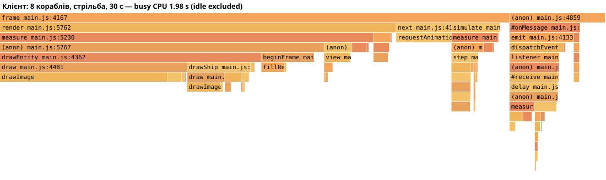

**Що змінено (і чому):**
- `view()` більше не створює нові `Vector2` і об'єкти для кожної сутності кожен кадр: view-об'єкти живуть у `Map` за
  id сутності й оновлюються на місці, вихідний масив перевикористовується (частка `frame` в алокаціях 20 % → ≤ 14 %);
- вибухи беруться з пулу, частинки — прості числа `{x, y, vx, vy}`, які змінюються на місці, а не `Vector2` на кожен
  кадр на кожну частинку;
- час кадрів — кільцевий `Float64Array` замість `push`/`shift` по масиву на 3000 елементів;
- буфер знімків 40 → 12 (400 мс замість 1.3 с) — гіпотеза «старі знімки доживають до old space». **Виміряно:
  не допомогло** (GC ті самі), лишив як є, бо інтерполяції більше й не треба.

**Чесний підсумок по GC.** Мета «нуль major GC» не досягнута. Дослідження: у стані спокою (та сама кімната без ботів)
major GC немає; у грі за 90 с їх 3 → 7 → 8 у кожних 30 с, тип — `finalize incremental marking via task`, купа
зменшується з ~6.6 до ~3.6 МБ, пауза ~4 мс. Тобто це інкрементальне маркування маленької купи (3–7 МБ), яке не
спричиняє пропущених кадрів (p99 16.8 мс). Основне джерело сміття, що лишилося, — `decodeSnapshot`: ~1000 об'єктів
на секунду (35 сутностей × 30 знімків). Наступний крок — декодувати знімок у пул об'єктів або в `Float32Array`
замість нових об'єктів.

### Профілювання сервера (`--cpu-prof`) і оптимізація

Сценарій: одна «щільна» кімната, 64 бот-клієнти (`server/scripts/loadtest.ts`, `PER_ROOM=64`, стрільба кожні 2 кроки),
`node --cpu-prof`, 26 с.

| Версія | tick p99 (64 гравці) | зайнятий CPU за 26 с | головні гарячі точки |
|---|---|---|---|
| до | 4.69 мс | 2.53 с | `writev` 34 %, **`encodeSnapshot` 29 %** |
| + кодування знімка один раз за тік | 2.58 мс | 1.49 с | `writev` 33 %, колізії (`naivePairs` + `resolveCollisions`) 10 % |
| + spatial hash | 2.28 мс | 0.98 с | `writev` 21 %, GC 8 % |

1. **Знімок кодувався окремо для кожного з 64 клієнтів**, хоча відрізняється лише 4 байти `ack`. Тепер
   `codec.prepareSnapshot()` кодує світ один раз, а копія для клієнта — це `ArrayBuffer.slice` + `setUint32(6, ack)`.
2. Після цього головною CPU-точкою стали колізії → `shared/src/sim/spatial-hash.ts` (сітка 64 px). Тест перевіряє,
   що він знаходить ті самі пари, що й O(n²).

Що лишилось — `writev`, тобто відправка байтів у сокети. Далі допомогли б лише дельта-знімки.

| До | Після |
|---|---|
| 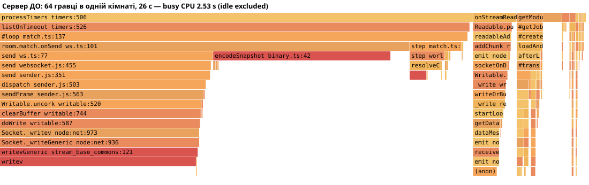 | 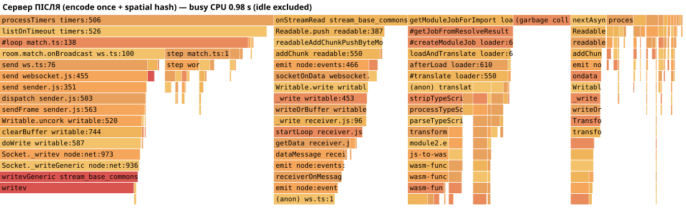 |

### Боти

`server/src/bot.ts` — `class Bot implements PlayerInput`: ухиляється від близьких астероїдів, переслідує найближчий
корабель, стріляє, коли приціл відхиляється менш ніж на 0.25 рад, блукає, якщо нікого немає. Бот генерує той самий
`InputMsg { seq, bits }`, що й людина, і проходить той самий шлях `Match.queueInput → Ship.applyInput` — сервер їх
не розрізняє. `POST /api/rooms/:id/bots {"count": N}` додає ботів, `DELETE` — прибирає.

### Web Worker: експеримент → не беру

`docs/experiments/worker-particles.html`: частинки в `Float32Array`, варіант «у воркері» передає буфер
(transferable, без копіювання) туди й назад щокадру. Міряли час **головного потоку** на кадр (середнє за 120 кадрів):

| Частинок | на головному потоці | з воркером (postMessage + отримання) |
|---|---|---|
| 144 (реальний максимум у грі: 8 вибухів × 18) | 0.004 мс | 0.040 мс |
| 2 000 | 0.008 мс | 0.044 мс |
| 20 000 | 0.111 мс | 0.040 мс |
| 200 000 | 0.928 мс | 0.038 мс |

Воркер вигідний лише від ~10–20 тис. частинок. У грі їх до ~150, і там воркер у **10 разів дорожчий** за звичайний
цикл, тож рішення — не використовувати (код лишився як експеримент).

### Навантажувальний тест і місткість

`server/scripts/loadtest.ts` запускає N headless WebSocket-клієнтів (binary-кодек, 30 входів/с, політ по скрипту,
стрільба), по 8 у кімнаті, і читає з `/api/stats` p99 тривалості тіку (найгірша кімната), джитер таймера,
зайнятість циклу подій (`performance.eventLoopUtilization`), RSS і вихідний трафік. Машина: 2 ядра, клієнти
й сервер на ній же.

| N | кімнат | tick p99, мс | джитер таймера p99, мс | ELU | RSS, МБ | вихід, KB/s |
|---|---|---|---|---|---|---|
| 8 | 1 | 0.68 | 1.8 | 2 % | 103 | 126 |
| 32 | 4 | 0.42 | 2.2 | 4 % | 111 | 484 |
| 64 | 8 | 0.43 | 2.3 | 6 % | 116 | 987 |
| 128 | 16 | 0.80 | 2.5 | 11 % | 130 | 1960 |
| 192 | 24 | 0.32 | 2.67 | 15 % | 136 | 2909 |
| 248 | 31 | 0.29 | 2.56 | 17 % | 135 | 3787 |

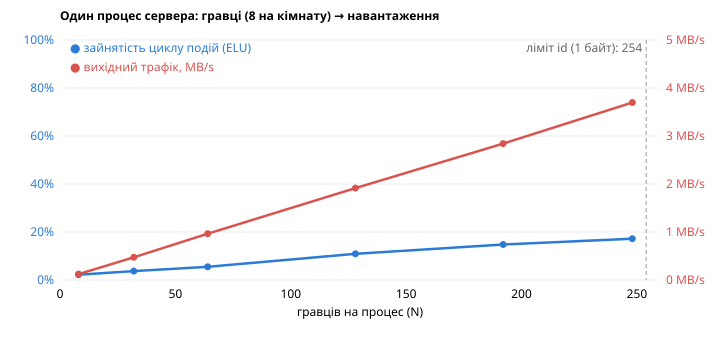

**Місткість: 248 гравців на процес** — і бюджет тіку (33 мс) при цьому навіть близько не вичерпано (ELU 17 %).
Межа не в CPU, а в **протоколі**: id гравця займає 1 байт (≤ 254 гравці на процес), і в **трафіку**: ~15 KB/s
на клієнта, 3.8 MB/s (~30 Мбіт/с) на 248 гравців. При лінійній екстраполяції ELU сягнув би 100 % приблизно на
1400 гравцях. В одній щільній кімнаті на 64 гравці tick p99 — 2.3 мс, але трафік уже 89 KB/s на клієнта:
кожен отримує ~350 сутностей 30 разів на секунду.

---

## Лаб 8. Публікуємо гру: Docker, метрики і жива адреса

### M1 — процес, готовий до продакшну

- **SIGTERM** → `server.close()` → кожному клієнту `shutdown` і закриття з кодом **1001** → зупинка логів матчів
  (pipeline дописує файл) → `exit(0)`. Додатково жорсткий дедлайн 8 с (`exit(1)`), щоб ніколи не перевищити 10 с
  на `docker stop`. Виміряно: **вихід за 7 мс з кодом 0**; три підключені клієнти отримали `shutdown` і 1001
  за 11 мс.
- **`/health`** (liveness: процес відповідає, `version` = git SHA збірки, `uptime`) і **`/ready`**
  (readiness: сервер слухає порт і не завершується; під час shutdown — `503`).
- **Падіння на невідомому:** `uncaughtException` / `unhandledRejection` → `logger.fatal` зі стеком → `exit(1)`;
  платформа піднімає чистий процес. Перевірено: кинутий `Error('boom…')` → лог `process.uncaught_exception`, код 1.
- **Логи — JSON-рядки через pino** у stdout, з полями `roomId`, `playerId`, `ip`, `version`; рівень — `LOG_LEVEL`.
  Пишуться події, а не прозові повідомлення: `room.created`, `player.joined`, `player.left`, `ws.rejected {reason}`,
  `ws.closed_by_server {reason}`, `server.shutdown_done {ms}`. Паролі, токени й повні повідомлення клієнтів у лог не потрапляють
  (`redact`).

  ```json
  {"level":30,"service":"dogfight","version":"c5fac45d1a2b","ip":"127.0.0.1","roomId":"alpha","playerId":2,"codec":"binary","msg":"player.joined"}
  {"level":40,"service":"dogfight","version":"c5fac45d1a2b","origin":"https://evil.example","reason":"origin","msg":"ws.rejected"}
  ```
- **`/metrics`** у форматі Prometheus (написаний вручну, `server/src/metrics.ts`): гравці, боти, кімнати, з'єднання,
  повідомлення і байти (лічильники `_total` + `*_per_second` між зчитуваннями), **tick p99 по кімнатах**, зайнятість
  циклу подій, RSS, **відмови за причиною** (`origin`, `ip_cap`, `rate_limit`, `bad_message`, `join_timeout`,
  `room_full`, `server_full`, `too_slow`).

  ```text
  dogfight_players 3
  dogfight_bytes_per_second{dir="out"} 1701.79
  dogfight_tick_seconds{room="alpha",quantile="0.99"} 0.00149
  dogfight_event_loop_utilization 0.0046
  dogfight_rss_bytes 104841216
  dogfight_rejected_total{reason="origin"} 1
  dogfight_rejected_total{reason="ip_cap"} 2
  ```
- **Версія** (git SHA, `ARG GIT_SHA` у Dockerfile) — у `/health` і в HUD гри (`v…`).
- **Конфіг через zod** (`server/src/config.ts`): `ALLOWED_ORIGINS`, `MAX_CONNECTIONS_PER_IP`, `MAX_ROOMS`,
  `MAX_PLAYERS_PER_ROOM`, `TRUST_PROXY`, `LOG_LEVEL`… Документація змінних — `.env.example`; `.env` у `.gitignore`.
  Секретів зараз немає; якщо з'являться (наприклад `SENTRY_DSN`) — лише в налаштуваннях платформи.

### M2 — захист

- **Origin на рукостисканні** (`verifyClient` у `ws.ts`): CORS на WebSocket не діє, тож без перевірки будь-який сайт
  міг би підключити своїх відвідувачів до нашого сервера. Чужий `Origin` → **403** (перевірено, пише `ws.rejected`).
  Клієнти без `Origin` (скрипти) пропускаються: зупиняти їх Origin однаково не може — для цього є ліміти.
- **Ліміт з'єднань з однієї IP** (8 за замовчуванням; за проксі IP береться з `X-Forwarded-For` при `TRUST_PROXY=true`):
  9-те з'єднання → **429**.
- Ліміти з Лаб 4 (розмір повідомлення, token bucket, таймаут `join`, повільний клієнт) лишились і перевірені
  навантажувальним скриптом з Лаб 7.

**Хаос-тести** (`server/scripts/chaos.ts` + браузерний сценарій):

| Сценарій | Що сталося |
|---|---|
| клієнт зник посеред матчу (`terminate()`, без close-фрейму) | сервер побачив закриття TCP, гравців у кімнаті 2 → 1, лог `player.left code 1006` |
| сервер убито посеред матчу (SIGTERM) | гравець **за 29 мс** опинився в лобі з повідомленням «The server is restarting… Pick a room to jump back in»; поки сервера немає, лобі повторює запит з backoff («Retrying in 3.6 s…»); після перезапуску кімнати з'явились за 3.3 с, повторний вхід працює |
| клієнт шле ~1000 битих кадрів/с (11 с, 1335 з'єднань) | кожне з'єднання закрито `4000`, залоговано й пораховано — `rejected_total{reason="bad_message"} 1335`; **tick p99 сусідньої кімнати** (7 ботів + гравець): **0.60 мс спокійно → 0.45 мс під атакою** — ізоляція доведена метрикою |

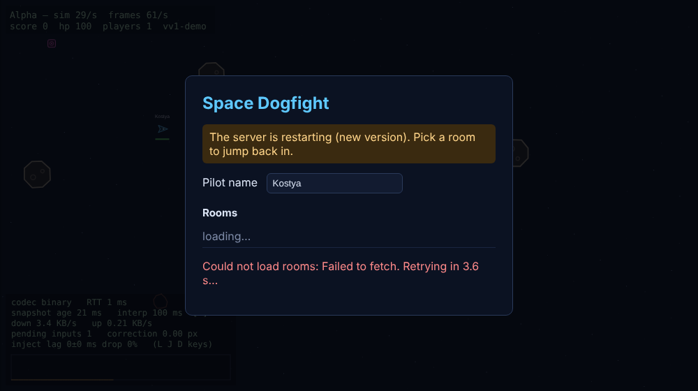

Знахідка: кадри, які вже були в дорозі до закритого сокета, рахувались і логувались повторно (10 разів на одне
з'єднання). Тепер є прапорець `closing` — один поганий клієнт = одна відмова й один рядок у лозі.

### M3 — контейнер і пайплайн

- **`Dockerfile` у два етапи:** stage 1 (`node:24-alpine`) — `npm ci` усього workspace, `vite build` клієнта;
  stage 2 — чистий `node:24-alpine`, лише `npm ci --omit=dev`, сирці сервера й `shared/` (Node виконує TypeScript
  сам — type stripping, без компілятора в образі) і `client/dist`. `NODE_ENV=production`, **`USER node`** (не root),
  **`CMD ["node", "server/src/index.ts"]`** у exec-формі (з `npm start` SIGTERM отримав би npm, а не Node),
  **`HEALTHCHECK`** на `/health`. Порядок шарів: спершу `package*.json` і встановлення залежностей, потім код —
  зміна коду не перезбирає `node_modules`. `.dockerignore` відкидає `node_modules`, `.git`, логи, `docs/`.
- **`docker-compose.yml`** — локальний запуск у продакшн-режимі (`stop_grace_period: 10s`).
- **CI** (`ci.yml`) на кожен push: typecheck → lint → тести → coverage → build → e2e.
- **Деплой за тегом** (`deploy.yml`): на тег `v*` → збірка образу з `GIT_SHA` → push у **GHCR**
  (`ghcr.io/lkostyaa/space-dogfight:<тег>` і `:latest`) → deploy hook **Render** (`render.yaml` — опис сервісу,
  health check `/ready`, `TRUST_PROXY=true`, Frankfurt) → крок чекає, поки `/health` живої адреси не покаже SHA цього коміту.
- TLS термінує edge Render, тому з публічної сторінки клієнт підключається лише через **`wss://`** (`wsUrl()` бере протокол
  зі сторінки). Проксі Render закриває «тихі» з'єднання — їх тримає heartbeat кожні 15 с з Лаб 4;
  `keepAliveTimeout` HTTP-сервера 65 с — більше, ніж idle timeout проксі.

### M4 — запуск

- **PWA:** `manifest.webmanifest`, іконки 192/512 (+ maskable), service worker (`public/sw.js`: network-first, API і
  WebSocket не кешуються), `display: fullscreen`, `orientation: landscape`. На телефоні — сенсорні кнопки
  (`ui/touch.ts`, лише для `pointer: coarse`).
- README переписано як сторінку продукту (угорі): GIF, посилання, як грати, схема, усі вимірювання, місткість,
  обмеження з причинами, наступні кроки, історія тегів.

### Деплой

- Гра: **https://space-dogfight.onrender.com** (Render, free, Frankfurt, образ `ghcr.io/lkostyaa/space-dogfight:latest`).
- Змінні оточення: `TRUST_PROXY=true`, `LOG_LEVEL=info`, `MAX_CONNECTIONS_PER_IP=8`,
  `ALLOWED_ORIGINS=https://space-dogfight.onrender.com`; health check — `/ready`.
- `/health` відповідає `{"ok":true,"version":"760f9adffd01",...}`; гра через `wss://` працює, RTT 37 мс.
- Безкоштовний інстанс засинає після простою — перший запит після паузи може йти ~50 с.
6. **Демо-відео 3–5 хв** і посилання на нього вгорі README.
